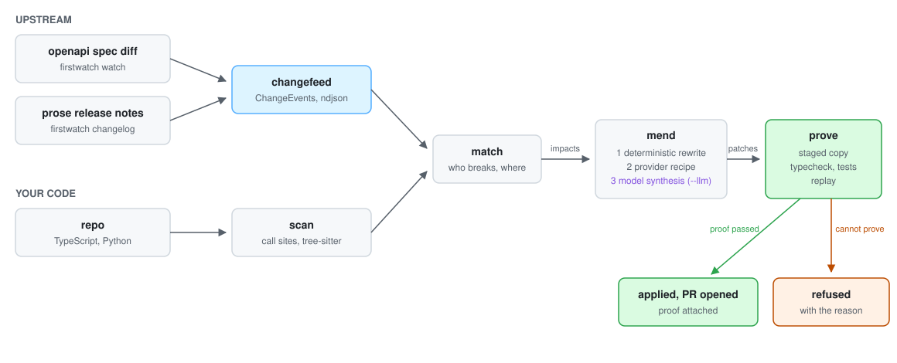

<div align="center">


**First eyes on upstream API changes.**

[](#the-proof-gate) [](#the-proof-gate) [](#bring-your-own-model) [](#build-from-source) [](#license)

</div>

The APIs your code depends on change without asking. Endpoints get removed, parameters get renamed, defaults flip, and you find out in production. Firstwatch finds the exact call sites a change hits, fixes what it can prove safe, and refuses the rest with a reason. It never guesses, and it never touches your tree without proof.

<picture>
  <source media="(prefers-color-scheme: dark)" srcset="docs/flow-dark.svg">
  
</picture>

**Contents**: [Install](#install) · [Quick start](#quick-start) · [Commands](#commands) · [The proof gate](#the-proof-gate) · [How fixes work](#how-fixes-work) · [Bring your own model](#bring-your-own-model) · [Many repos](#many-repos) · [CI and providers](#run-it-in-ci) · [Going deeper](#going-deeper)

## Install

```sh
curl -fsSL https://raw.githubusercontent.com/firstwatch-dev/firstwatch/main/install.sh | sh
```

One static binary. No runtime, no account, no config.

## Quick start

Point it at any repo. It detects which SDKs you use from the code itself.

```sh
firstwatch check --events registry/stripe/changefeed.ndjson
```

```
[BREAKS NOW] src/billing.ts:10 orders.create (Removed)
    return stripe.orders.create({ items });
[DEPRECATED] src/billing.ts:6 charges.create (Deprecated)
    return stripe.charges.create({ amount, currency: "usd", customer: customerId });
firstwatch: 3 impacts across 7 call sites, 2 breaking.
```

Then let it fix what it can prove:

```sh
firstwatch fix --events registry/stripe/changefeed.ndjson            # dry run
firstwatch fix --events registry/stripe/changefeed.ndjson --write    # apply, if proof passes
firstwatch pr  --events registry/stripe/changefeed.ndjson            # same, as a pull request
```

Changefeeds describe what changed upstream. Ready-made feeds for Stripe, OpenAI, and GitHub ship in [`registry/`](registry/), or make your own from any two OpenAPI specs or a release-notes page (see [Commands](#commands)).

## Commands

| Command | What it does |
|---|---|
| `firstwatch check` | Report which call sites a changefeed hits, ranked by severity |
| `firstwatch fix` | Propose patches; `--write` applies them after proof |
| `firstwatch pr` | Fix on a branch, commit, push, open a PR with the proof attached |
| `firstwatch watch` | Diff two OpenAPI specs into a changefeed |
| `firstwatch changelog` | Parse prose release notes into a changefeed (flagged low confidence) |
| `firstwatch blast` | Which repos in a fleet break, before anything ships. Read-only |
| `firstwatch fleet` | Run the whole pipeline across many repos, PRs included |
| `firstwatch scan` / `match` | The underlying blocks, composable as Unix pipes |

## The proof gate

Patches are never applied directly. They go to a staged copy of your repo first, where your own verifiers run:

- **Typecheck**, detected automatically (`tsc --noEmit` when a tsconfig exists)
- **Your test suite**, with `--with-tests`
- **Differential replay**, with `--replay <cmd>`: the same command runs against unpatched and patched copies, and the output must be identical

Only a passing verdict lets anything touch your real tree:

```
[prove] typecheck (tsc --noEmit) FAILED
src/billing.ts(8,40): error TS2741: Property 'confirm' is missing ...
firstwatch: refused to apply 1 patches, proof failed. Your tree is untouched.
```

Anything firstwatch cannot fix or prove becomes a refusal with a reason, never a silent skip and never a guess. Pull requests carry the proof checks, evidence links per patch, and a "needs human attention" section listing every refusal.

## How fixes work

Three tiers, in order of trust:

1. **Deterministic rewrites**. The change names its replacement and the call site still matches what the scanner saw.
2. **Provider recipes**. Fix steps shipped as data next to the changefeed: rename this surface, add this field, rename that parameter where present. Authored by providers or the community, see [docs/registry.md](docs/registry.md).
3. **Model synthesis** (`--llm`, off by default). For changes that need judgment, like a flipped default that should be pinned explicitly. Synthesized patches are always labeled.

Every tier faces the same proof gate. A wrong recipe or a bad model cannot ship broken code; it can only get refused.

## Bring your own model

The default is Claude with your own key:

```sh
export ANTHROPIC_API_KEY=...
```

Any OpenAI-compatible server works (Ollama, vLLM, Groq, OpenRouter, company gateways):

```sh
export FIRSTWATCH_LLM_PROVIDER=openai
export FIRSTWATCH_LLM_BASE_URL=http://localhost:11434/v1/chat/completions
export FIRSTWATCH_LLM_MODEL=llama3.1
```

For internal APIs with custom auth, bring any executable that reads a prompt on stdin and writes JSON to stdout:

```sh
export FIRSTWATCH_LLM_CMD=./my-llm-bridge.sh
```

Your credentials never enter firstwatch. Whichever model you bring, the proof gate stays the judge.

## Many repos

```sh
firstwatch blast --repos repos.txt --events changefeed.ndjson
```

Blast answers "who breaks if this ships" across repo paths or clone URLs: per-repo counts, per-change site lists, nonzero exit for CI gating.

```sh
firstwatch fleet --repos repos.txt --events changefeed.ndjson --llm
```

Fleet runs the whole pipeline per repo and opens PRs. Proven fixes propagate: the first proven patch for a change becomes the template for the same change in every later repo, so each unique change is synthesized at most once and every repo still gets its own proof.

## Run it in CI

```yaml
- uses: firstwatch-dev/firstwatch/action@main
  with:
    events: registry/stripe/changefeed.ndjson
```

Fails the build when a changefeed breaks the repo.

## For API providers

Drop the publish action into the repo that holds your OpenAPI spec, and every release appends its changes to your changefeed automatically. Ship recipes next to it and your customers get proven fixes instead of warnings.

```yaml
- uses: firstwatch-dev/firstwatch/action/publish@main
  with:
    spec: openapi/spec.json
    provider: yourname
```

## Going deeper

- [How firstwatch works](docs/architecture.md): the five blocks, the data shapes, the registry model, and the design rules
- [The registry guide](docs/registry.md): add a provider, author a changefeed, write fix recipes
- [`bindings/`](bindings/): the scan, match, and diff engine as Node and Python libraries

## Build from source

```sh
cargo build --release
cargo test
```

## Status

v0.1. The schema is versioned but not yet stable. The Stripe changefeed in `registry/` is generated from real stripe/openapi history.

## License

Apache-2.0
